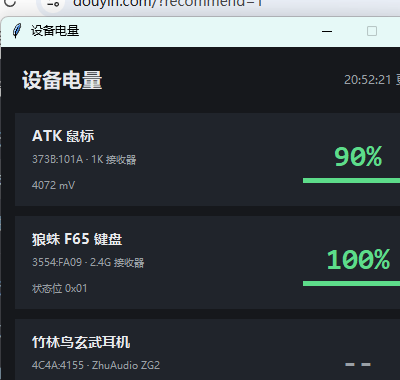

# atk-langzhuF65-2.4G-battery

Windows 上的 **无线外设电量托盘**：ATK 鼠标、狼蛛 F65 键盘各一个数字图标（图标内容就是电量），
竹林鸟玄武耳机目前读不到（原因见文末）。

纯 Python 标准库 + `ctypes`，没有 hidapi / pystray / Pillow 依赖。



## 功能

- 托盘里每台设备一个图标，绿色数字就是电量（≥60 绿 / 30–59 黄 / <30 红）
- 左键图标立刻刷新；右键菜单：刷新 / 打开面板 / 开机自启 / 退出
- 悬停显示设备名、电量、电压、更新时间
- 默认 60 秒刷新一次（`SetTimer` 驱动，空闲几乎不占 CPU）
- 鼠标休眠时保留上一次读数，并标注「上次 HH:MM:SS」

## 运行

```bash
python  tray_app.py --once     # 只在终端打印一次
python  tray_app.py --debug    # 前台运行，打印读取过程
pythonw tray_app.py            # 静默驻留（推荐）
python  panel.py               # 单独打开面板
python  tray_app.py --autostart on|off|status   # 开机自启
```

Windows 11 默认会把新图标收进托盘溢出区（`^`），在「设置 → 个性化 → 任务栏 →
其他系统托盘图标」里可以设为常显。

## 打包

```bash
python -m pip install pyinstaller
python -m PyInstaller --noconfirm --clean --onedir --windowed --name BatteryTray ^
    --hidden-import panel --hidden-import win_shell tray_app.py
```

产物在 `dist/BatteryTray/`（exe + `_internal` 文件夹，两个必须放在一起）。

> onefile（单 exe）模式在部分机器上会报 `Could not create temporary directory`，
> 所以默认用 onedir。

开机自启 = 在 `shell:startup` 放一个指向 `BatteryTray.exe` 的快捷方式；
托盘右键菜单里的「开机自启」会自动创建/删除它。

## 协议

| 设备 | VID:PID | 接口 | 帧格式 |
|---|---|---|---|
| ATK 鼠标（1K 接收器） | `373B:101A` | usage page `0xFF02`，17 字节，Report ID `0x08` | `[cmd,status,addr_lo,addr_hi,len,data…,crc]`，`crc = 0x55 - ((sum(frame[0:15]) + 8) & 0xFF)`；`0x03` 查在线、`0x04` 读电量（回复 `data[5]=电量%`、`data[6]=充电`、`data[7:9]=电压 mV 大端） |
| 狼蛛 F65 | `3554:FA09` | usage page `0xFF02`，20 字节，Report ID `0x13` | `[0x13,cmd,sub,seq,data…,crc]`，`crc = sum(frame[0:19]) & 0xFF`；命令 `0x4A` 返回 `data[0]=电量%`、`data[1]=状态位` |
| 竹林鸟玄武 ZG2 | `4C4A:4155` | 只有 consumer-control HID（3 字节输入，无输出/Feature） | **读不到** |

ATK 的 COMPX 帧与命令字节来自对官方 ATK HUB（Electron）的分析；
狼蛛的 20 字节 / `0x13` 帧格式参考了 [Aula-F87-Controller](https://github.com/marcoslor/Aula-F87-Controller) 的逆向文档，
`0x4A` 电量命令是对设备逐条探测得到的。

## 已知限制

- **ATK 鼠标休眠时不回复**：需要动一下鼠标。程序会保留上次读数。
- **狼蛛的 `0x4A` 第二个字节含义未确认**（观察值 `0x01`），界面不把它当充电标志。
- **竹林鸟玄武读不到电量**：接收器只暴露 USB Audio + 一个 3 字节 consumer HID，
  没有厂商接口、没有 Output/Feature report；耳机开/关机时接口集合不变，HID 也无任何广播；
  官方驱动面板里也没有电量功能。属于设备本身不提供，不是程序问题。

## 文件

- `hidlib.py` —— HID 枚举 + Overlapped 读写（避免「阻塞读 + 并发写」杀进程）
- `devices.py` —— 三台设备的协议实现，`python devices.py` 可直接打印
- `win_icon.py` —— 点阵数字 → ICO → HICON（图标就是电量数字）
- `win_shell.py` —— 已知文件夹 + 纯 ctypes 创建 `.lnk`
- `tray_app.py` —— 托盘程序
- `panel.py` —— tkinter 面板

## 说明

私有协议部分是通过分析厂商软件与设备行为得到的，仅供学习与个人使用。
